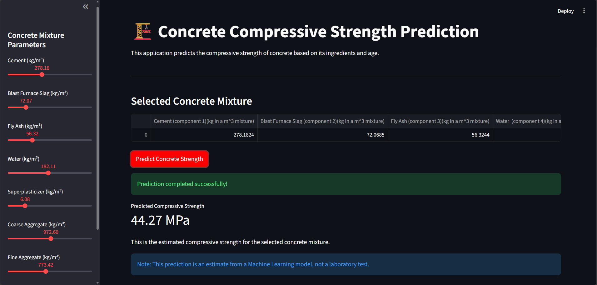

# Concrete Compressive Strength Prediction

## UI Screenshot



A Streamlit application that estimates the compressive strength of a concrete mixture from its ingredient quantities and curing age. The app loads a trained model from `models/best_model.pkl` and displays its prediction in MPa.

## Features

- Adjust eight mixture inputs with sliders: cement, blast furnace slag, fly ash, water, superplasticizer, coarse aggregate, fine aggregate, and age.
- View the selected inputs and request a strength prediction.
- Input slider ranges and defaults are taken from the saved model bundle's feature statistics.

## Project files

```text
.
├── app.py                         # Streamlit application
├── requirements.txt               # Python dependencies
├── data/
│   └── Concrete_Data.xls           # Dataset
├── models/
│   └── best_model.pkl              # Trained model and feature metadata
└── notebooks/
    └── main.ipynb                  # Data exploration and model development
```

## Requirements

- Python 3.10 or later
- The packages listed in `requirements.txt`

## Run the application

From the project directory, create and activate a virtual environment, then install the dependencies:

```bash
python -m venv .venv
```

Windows PowerShell:

```powershell
.venv\Scripts\Activate.ps1
```

macOS or Linux:

```bash
source .venv/bin/activate
```

Install the packages and start Streamlit:

```bash
python -m pip install -r requirements.txt
streamlit run app.py
```

Streamlit will print a local URL (usually `http://localhost:8501`) to open in your browser.

## Model and data

The app expects `models/best_model.pkl` to contain a joblib-serialized dictionary with these keys:

- `model`: an estimator with a `predict` method
- `feature_names`: the input feature names, in the order expected by the estimator
- `feature_stats`: per-feature `min`, `max`, and `mean` values used to configure the input sliders

The source dataset is in `data/Concrete_Data.xls`. The notebook in `notebooks/main.ipynb` contains the project's analysis and model-development workflow.

## Prediction note

Predictions are model estimates based on the provided mixture inputs. They are not a substitute for laboratory testing or engineering judgment.
